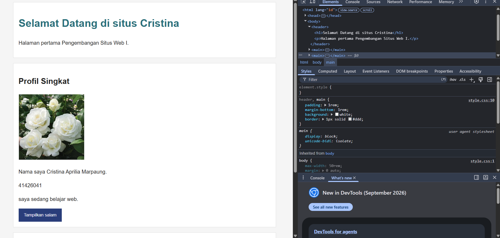
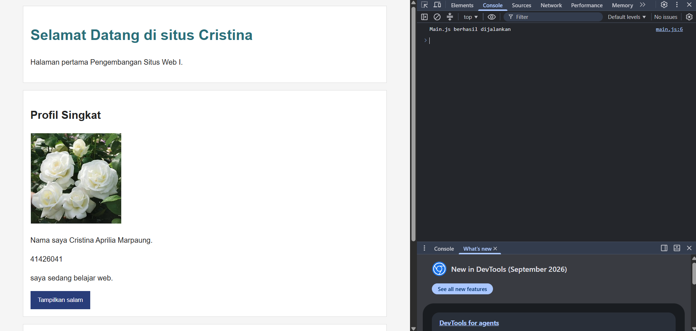

Tangkapan Layar Elements

Tangkapan Layar Console

Tangkapan layar 200

Tangkapan Layar

Laporan Debugging
Debugging adalah proses untuk mencari, menemukan, dan memperbaiki kesalahan atau bug dalam sebuah program. Debugging dilakukan agar program dapat berjalan dengan benar sesuai dengan yang diharapkan. Biasanya, program ini meliputi pemeriksaan kode, menemukan penyebab kesalahan, memperbaiki kode, lalu menjalankan program kembali untuk memastikan masalah sudah terselesaikan dengan baik
Gejala: CSS tidak aktif
Bukti: css/style1.css
Penyebab: Penamaan salah
Perbaikan: Memnyesuaikan penamaannya
Hasil: 200

Struktur Folder

git status

git log --oneline

Minimal 2 comit
Komit 1

komit 2

